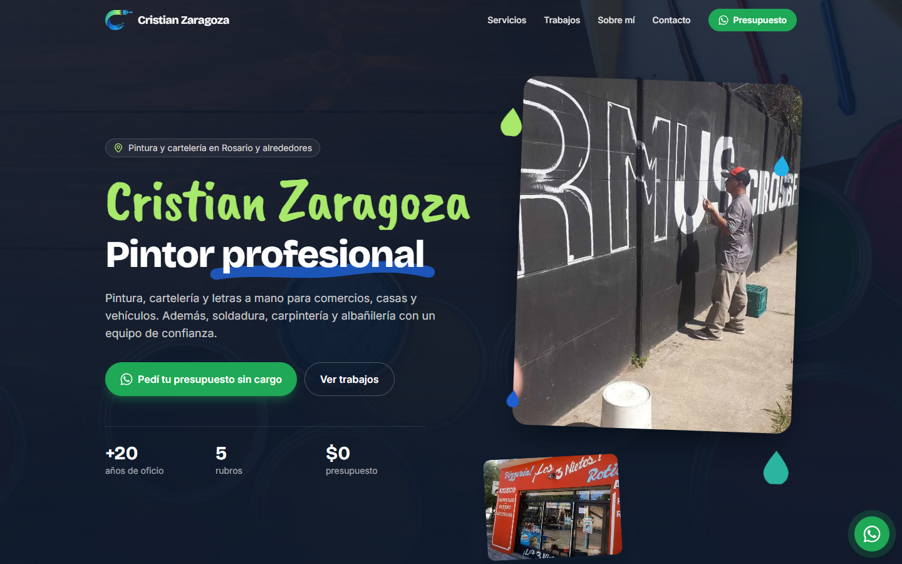
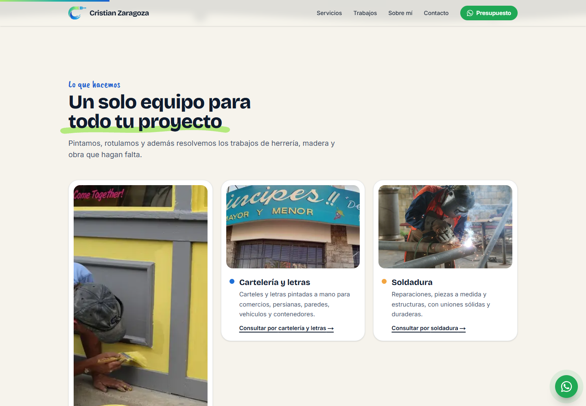
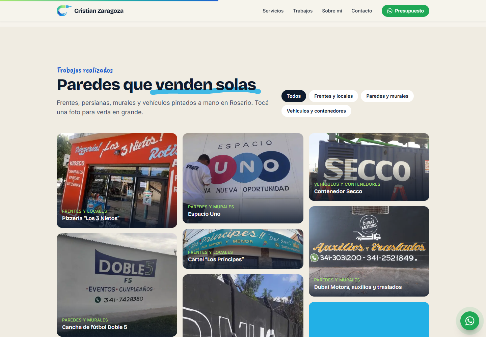
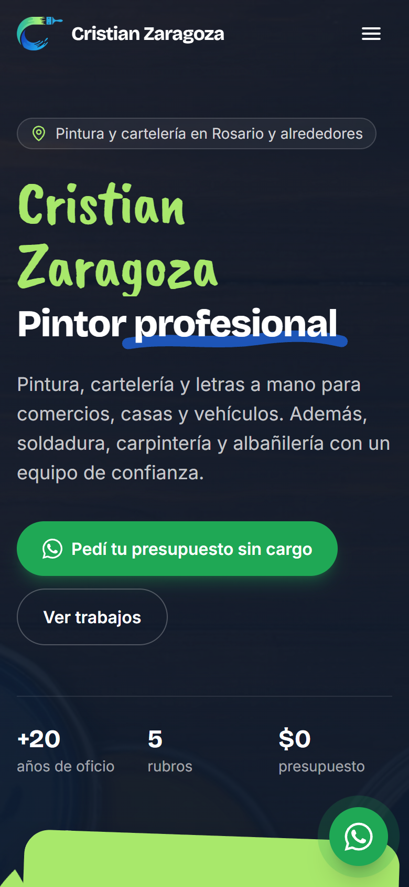

# Cristian Zaragoza · Pintura y cartelería en Rosario

Sitio web profesional para **Cristian Zaragoza**, pintor y cartelista de Rosario (Argentina) con una trayectoria familiar en letras pintadas a mano. Es una página pensada para un profesional de oficios: muestra los trabajos reales, explica los servicios y lleva al cliente directo a pedir presupuesto por WhatsApp.

**Sitio en vivo:** https://cristian-zaragoza.vercel.app



| Servicios | Galería | Celular |
|---|---|---|
|  |  |  |

## Qué tiene

- **Galería de trabajos** con filtros por tipo (frentes, murales, vehículos) y visor a pantalla completa con teclado y gesto de deslizar en el celular.
- **Contacto por WhatsApp** en un toque: botón flotante, mensaje precargado y consultas por servicio.
- **Animaciones con temática de pintura:** el nombre se "pinta" a pincel, los títulos se subrayan con una pincelada, las fotos aparecen como una pasada de rodillo, gotas de pintura flotando, chorreado entre secciones y tarjetas que se llenan de color. Todas respetan `prefers-reduced-motion`.
- **SEO local:** metadatos en español (es-AR), Open Graph para compartir, datos estructurados `HousePainter` (schema.org), `sitemap.xml` y `robots.txt`.
- **Rápido:** exportación 100 % estática, fotos en WebP (de 53 MB a menos de 3 MB) y fuentes autoalojadas con `next/font`.
- **Responsive** desde 360 px hasta pantallas grandes.

## Stack

- [Next.js 16](https://nextjs.org) (App Router, `output: "export"`)
- React 19 + TypeScript
- Tailwind CSS 4
- `sharp` para optimizar fotos y generar la imagen para redes
- Animaciones con CSS e `IntersectionObserver`, sin librerías extra

## Estructura

```
app/            layout (SEO + JSON-LD), página, sitemap, robots, 404
components/     Portada, Servicios, Galeria, SobreMi, Contacto, Pie, Encabezado...
lib/datos.ts    todos los datos del cliente: teléfono, redes, servicios y trabajos
public/fotos/   fotos optimizadas (<nombre>.webp y <nombre>-sm.webp)
scripts/        optimizar-fotos.mjs y generar-og.mjs
```

Para cambiar un teléfono, sumar un servicio o un trabajo nuevo alcanza con editar `lib/datos.ts`.

## Desarrollo

```bash
npm install
npm run dev        # http://localhost:3000
npm run build      # genera out/ (sitio estático)
```

### Sumar fotos nuevas

```bash
node scripts/optimizar-fotos.mjs <carpeta-con-fotos>   # genera los .webp en public/fotos
```

Después se agrega el trabajo en `lib/datos.ts` con su título, categoría y texto alternativo.

## Deploy

Vercel lo detecta solo como proyecto Next.js. En cualquier otro hosting estático (Netlify, GitHub Pages) se publica la carpeta `out/`. La variable opcional `NEXT_PUBLIC_SITIO_URL` define el dominio usado en el sitemap y en los metadatos.

## Créditos

Desarrollado por [Facundo Quinteros](https://www.linkedin.com/in/facundo-quinteros-125051232) y [Lautaro Lucero](https://www.linkedin.com/in/lautaro-tomas-lucero-3326b5227). Versión original en 2023; rediseño en 2026.
